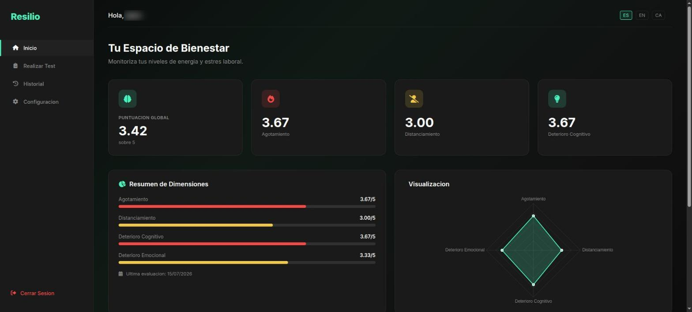
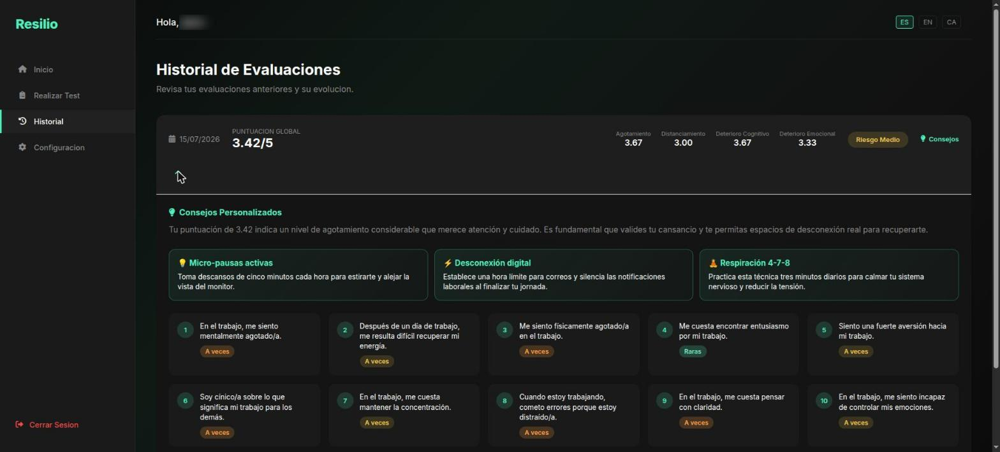
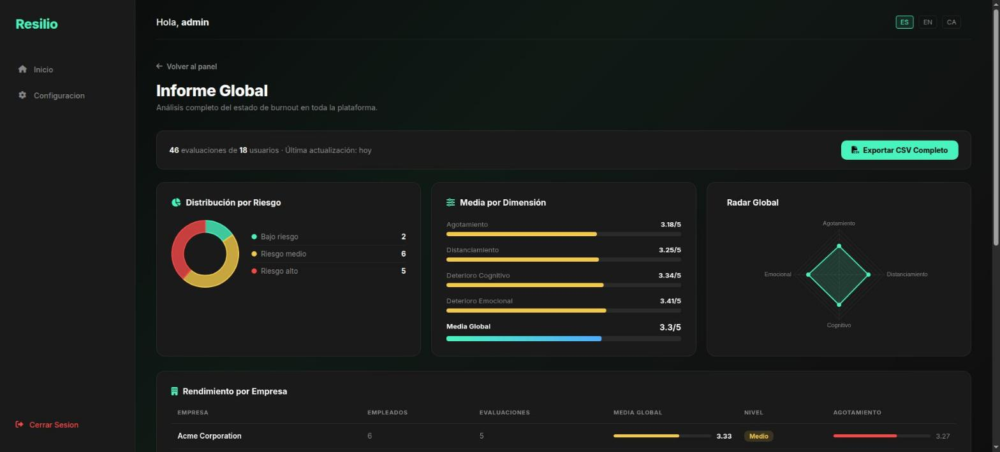

<div align="center">


# Resilio — Plataforma de Detección del Burnout

*Equilibrio entre mente y código*

[](https://resilio-production.up.railway.app)


</div>

**Resilio** es una aplicación web para evaluar, monitorizar y prevenir el Síndrome de Burnout (agotamiento profesional) en entornos organizacionales y personales.

Aplica el **test BAT-12** (Burnout Assessment Tool) y usa **Google Gemini** para generar consejos personalizados a partir de los resultados de cada persona.

👉 **[Prueba la demo en producción](https://resilio-production.up.railway.app)**

## 📸 Capturas

### Panel personal



### Test BAT-12 e historial con consejos de IA

| Test BAT-12 | Historial con consejos personalizados |
|:---:|:---:|
|  |  |

### Panel de administración




### Acceso a la cuenta

| Inicio de sesión | Registro | Recuperar contraseña |
|:---:|:---:|:---:|
|  |  |  |

La interfaz está disponible en **español, inglés y catalán** (selector `ES / EN / CA` arriba a la derecha).

## 🚀 Características

- **Evaluación científica (BAT-12):** 12 preguntas en escala 1–5 repartidas en 4 dimensiones: Agotamiento, Distanciamiento Mental, Deterioro Cognitivo y Deterioro Emocional.
- **Consejos con IA:** tras cada test, Gemini genera recomendaciones de bienestar que se guardan junto a la evaluación. Si no hay API key o la llamada falla, la app sigue funcionando con un mensaje de respaldo.
- **Cuatro roles**, cada uno con su propio panel:

  | Rol | Qué ve y qué puede hacer |
  |-----|--------------------------|
  | **Administrador** | Estadísticas globales, alta de empresas y usuarios, exportación CSV e informe global. |
  | **Recursos Humanos** | Métricas agregadas de los empleados de su empresa, sin exponer datos individuales. |
  | **Empleado** (usuario de empresa) | Test, historial, evolución y consejos de IA. Se registra con el código de su empresa. |
  | **Personal** | Lo mismo que el empleado, sin vinculación a ninguna empresa. |

- **Cuentas:** registro, inicio de sesión y recuperación de contraseña por email (enlace con caducidad de 1 hora).
- **Exportación:** descarga de datos en CSV para análisis externo.

## 🛠️ Tecnologías

- **Backend:** Python 3.11, Flask, Werkzeug, Flask-Mail
- **Base de datos:** MySQL con `mysql-connector-python` (SQL directo, sin ORM)
- **IA:** Google Gemini (`google-genai`)
- **Frontend:** plantillas Jinja2, HTML5, CSS3 y JavaScript
- **Despliegue:** Gunicorn + Railway
- **Configuración:** `python-dotenv`

## ⚙️ Instalación y ejecución en local

### Requisitos

- Python 3.11
- MySQL 8 (o MariaDB compatible)
- Una [API key de Gemini](https://aistudio.google.com/apikey) *(opcional)*

### 1. Clonar e instalar dependencias

```bash
git clone https://github.com/pierooof/Resilio.git
cd Resilio/back
python -m venv venv
source venv/bin/activate        # En Windows: venv\Scripts\activate
pip install -r requirements.txt
```

### 2. Crear la base de datos

El script crea la base `resilio_db` con las tablas, las 4 dimensiones, las preguntas del BAT-12, los roles y una empresa de ejemplo.

> ⚠️ El script hace `DROP DATABASE` de `resilio_db` antes de recrearla. No lo ejecutes sobre datos que quieras conservar.

```bash
mysql -u <usuario> -p < database/resilio_db_actual.sql
```

### 3. Configurar las variables de entorno

Crea el archivo `back/.env`:

```env
DB_HOST=localhost
DB_USER=<usuario_mysql>
DB_PASSWORD=<contraseña_mysql>
DB_NAME=resilio_db
SECRET_KEY=<cadena_aleatoria_larga>
GEMINI_API_KEY=<tu_api_key>        # opcional
PORT=5000                          # opcional

# Solo para "¿Olvidaste tu contraseña?" (opcional)
MAIL_SERVER=smtp.gmail.com
MAIL_PORT=587
MAIL_USE_TLS=True
MAIL_USERNAME=<tu_correo>
MAIL_PASSWORD=<contraseña_de_aplicacion>
```

| Variable | Obligatoria | Descripción |
|----------|:-----------:|-------------|
| `DB_HOST`, `DB_USER`, `DB_PASSWORD`, `DB_NAME` | Sí | Conexión a MySQL. |
| `SECRET_KEY` | Sí | Firma las sesiones y los enlaces de recuperación. Puedes generarla con `python -c "import secrets; print(secrets.token_hex(32))"`. |
| `GEMINI_API_KEY` | No | Sin ella, se guarda un mensaje genérico en lugar de los consejos de IA. |
| `PORT` | No | Puerto del servidor (por defecto `5000`). |
| `MAIL_*` | No | Servidor SMTP para el correo de recuperación. En Gmail usa una *contraseña de aplicación*. |

### 4. Arrancar

```bash
python app.py
```

Abre <http://localhost:5000>. En producción se usa `gunicorn app:app` (ver `Procfile`).

### 5. Primeros pasos

El script SQL no crea usuarios, así que:

1. **Regístrate** en `/register`. Sin código de empresa serás usuario *Personal* (rol 3); con el código `TECH-2026-VIP` (empresa de ejemplo) serás *Empleado* (rol 4).
2. **Crea un administrador:** regístrate y después promociónate desde MySQL:

   ```sql
   UPDATE usuarios SET rol_id = 1 WHERE email = 'tu@email.com';
   ```

3. Desde el panel de administración puedes crear empresas y usuarios de RRHH (rol 2).
4. Haz el test en `/test` y consulta el resultado y los consejos en `/dashboard` e `/historial`.

## 📁 Estructura del proyecto

```text
Resilio/
├── back/
│   ├── app.py                ← Rutas, autenticación y consultas SQL
│   ├── Procfile              ← Arranque en producción (gunicorn)
│   ├── requirements.txt
│   ├── conexion/
│   │   └── conexion_bbdd.py  ← Conexión a MySQL
│   ├── database/
│   │   ├── resilio_db_actual.sql   ← Crea la BD con datos iniciales
│   │   └── schema.sql              ← Volcado del esquema
│   ├── servicios/
│   │   ├── test_service.py   ← Cálculo y guardado del BAT-12
│   │   └── ia_service.py     ← Integración con Gemini
│   ├── static/               ← CSS e imágenes
│   └── templates/
│       ├── dashboards/       ← Paneles por rol (admin, hr, empleado, personal)
│       ├── test.html         ← Cuestionario
│       └── historial.html    ← Histórico de resultados
├── docs/screenshots/         ← Capturas del README
├── Estructura.txt
└── README.md
```

## 🗺️ Rutas principales

| Ruta | Descripción |
|------|-------------|
| `/login`, `/register`, `/logout` | Autenticación |
| `/forgot_password`, `/reset_password/<token>` | Recuperación de contraseña |
| `/dashboard` | Panel según el rol del usuario |
| `/test`, `/procesar_test` | Cuestionario BAT-12 y su procesado |
| `/historial` | Evaluaciones anteriores |
| `/admin/*` | Altas, exportación CSV e informe global *(solo administradores)* |
