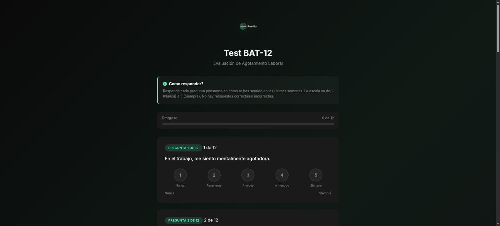
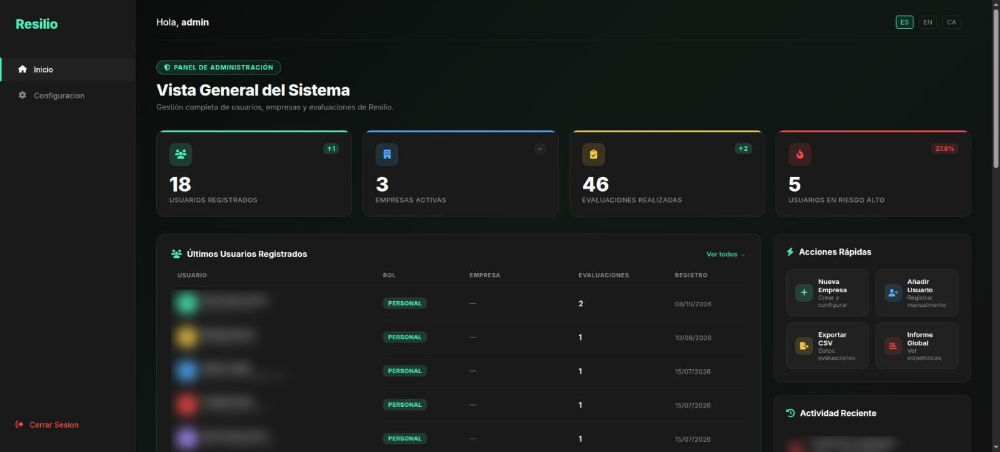
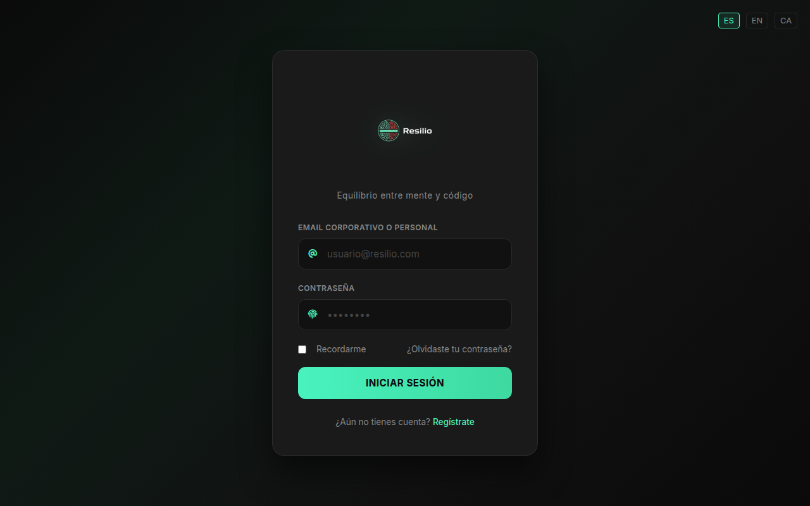
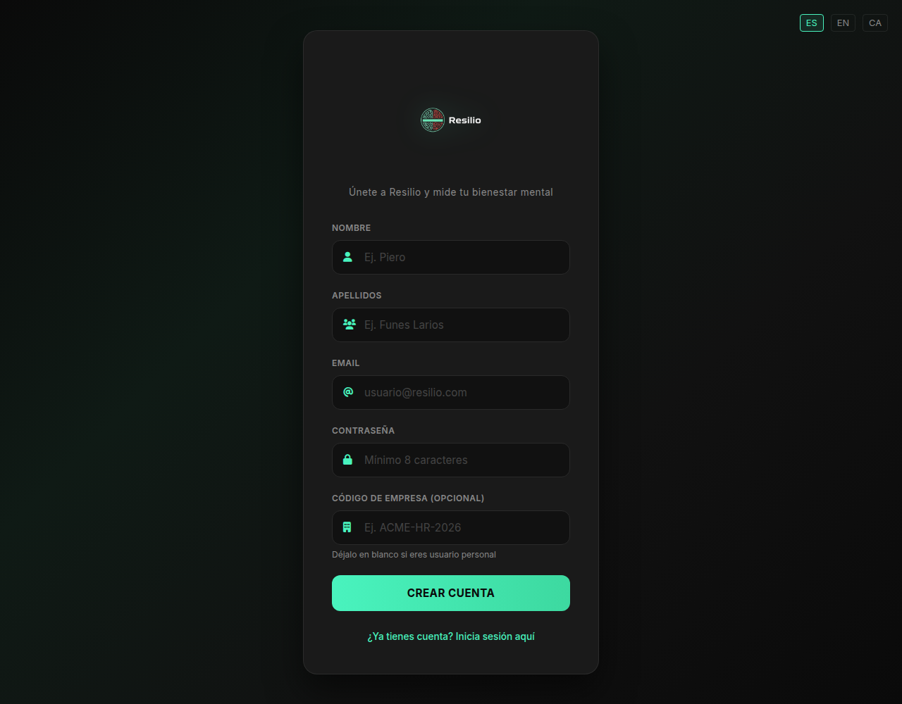
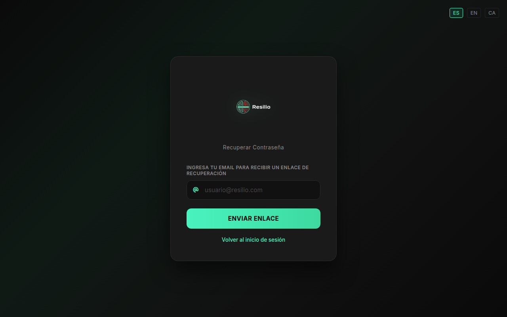

<div align="center">


# Resilio — Plataforma de Detección del Burnout

*Equilibrio entre mente y código*

[](https://resilio-production.up.railway.app)


</div>

**Resilio** es una aplicación web para evaluar, monitorizar y prevenir el Síndrome de Burnout (agotamiento profesional) en entornos organizacionales y personales.

Aplica el **test BAT-12** (Burnout Assessment Tool) y usa **Google Gemini** para generar consejos personalizados a partir de los resultados de cada persona.

👉 **[Prueba la demo en producción](https://resilio-production.up.railway.app)**

## 📸 Capturas

### Panel personal


### Test BAT-12 e historial con consejos de IA

| Test BAT-12 | Historial con consejos personalizados |
|:---:|:---:|
|  |  |

### Panel de administración




### Acceso a la cuenta

| Inicio de sesión | Registro | Recuperar contraseña |
|:---:|:---:|:---:|
|  |  |  |

La interfaz está disponible en **español, inglés y catalán** (selector `ES / EN / CA` arriba a la derecha).

## 🚀 Características

- **Evaluación científica (BAT-12):** 12 preguntas en escala 1–5 repartidas en 4 dimensiones: Agotamiento, Distanciamiento Mental, Deterioro Cognitivo y Deterioro Emocional.
- **Consejos con IA:** tras cada test, Gemini genera recomendaciones de bienestar que se guardan junto a la evaluación. Si no hay API key o la llamada falla, la app sigue funcionando con un mensaje de respaldo.
- **Cuatro roles**, cada uno con su propio panel:

  | Rol | Qué ve y qué puede hacer |
  |-----|--------------------------|
  | **Administrador** | Estadísticas globales, alta de empresas y usuarios, exportación CSV e informe global. |
  | **Recursos Humanos** | Métricas agregadas de los empleados de su empresa, sin exponer datos individuales. |
  | **Empleado** (usuario de empresa) | Test, historial, evolución y consejos de IA. Se registra con el código de su empresa. |
  | **Personal** | Lo mismo que el empleado, sin vinculación a ninguna empresa. |

- **Cuentas:** registro, inicio de sesión y recuperación de contraseña por email (enlace con caducidad de 1 hora).
- **Exportación:** descarga de datos en CSV para análisis externo.

## 🛠️ Tecnologías

- **Backend:** Python, Flask (blueprints, Flask-WTF, Flask-Limiter, Flask-Babel), Werkzeug, Flask-Mail
- **Base de datos:** PostgreSQL con SQLAlchemy 2 y Alembic (Flask-Migrate)
- **IA:** Google Gemini (`google-genai`)
- **Frontend:** plantillas Jinja2, HTML5, CSS3, JavaScript y HTMX
- **Despliegue:** Gunicorn + Railway
- **Configuración:** `python-dotenv`

## ⚙️ Instalación y ejecución en local

### Requisitos

- Python 3.13
- PostgreSQL 14 o superior
- Una [API key de Gemini](https://aistudio.google.com/apikey) *(opcional)*

### 1. Clonar e instalar dependencias

```bash
git clone https://github.com/pierooof/Resilio.git
cd Resilio/back
python -m venv venv
source venv/bin/activate        # En Windows: venv\Scripts\activate
pip install -r requirements.txt
```

### 2. Configurar las variables de entorno

Crea el archivo `back/.env`:

```env
DATABASE_URL=postgresql://<usuario>:<contraseña>@localhost:5432/resilio
SECRET_KEY=<cadena_aleatoria_larga>
COOKIE_SECURE=0                    # solo en local (http)
GEMINI_API_KEY=<tu_api_key>        # opcional
PORT=5000                          # opcional

# Solo para "¿Olvidaste tu contraseña?" y los recordatorios (opcional)
MAIL_SERVER=smtp.gmail.com
MAIL_PORT=587
MAIL_USE_TLS=True
MAIL_USERNAME=<tu_correo>
MAIL_PASSWORD=<contraseña_de_aplicacion>
APP_URL=http://localhost:5000
```

| Variable | Obligatoria | Descripción |
|----------|:-----------:|-------------|
| `DATABASE_URL` | Sí | Conexión a PostgreSQL (acepta `postgres://` y `postgresql://`). Railway la proporciona. |
| `SECRET_KEY` | Sí | Firma las sesiones y los enlaces de recuperación. Puedes generarla con `python -c "import secrets; print(secrets.token_hex(32))"`. |
| `COOKIE_SECURE` | No | `1` por defecto; ponla a `0` solo si trabajas en local sin HTTPS. |
| `GEMINI_API_KEY` | No | Sin ella se muestran consejos fijos en lugar de los generados por IA. |
| `ADMIN_EMAIL`, `ADMIN_PASSWORD` | No | Si existen, el arranque crea ese administrador (una sola vez). |
| `MAIL_*`, `APP_URL` | No | Correo de recuperación y recordatorios. En Gmail usa una *contraseña de aplicación*. |
| `PORT` | No | Puerto del servidor (por defecto `5000`). |

### 3. Crear la base de datos

```bash
createdb resilio
flask --app app db upgrade      # crea las tablas
flask --app app seed            # roles, dimensiones y las 12 preguntas BAT-12 (es/en/ca)
```

### 4. Arrancar

```bash
python app.py
```

Abre <http://localhost:5000>. En producción se usa el `Procfile` (migraciones, datos base, admin y `gunicorn`).

### 5. Primeros pasos

1. **Crea un administrador:** `flask --app app crear-admin tu@email.com` (pide la contraseña).
2. Desde el panel de administración crea empresas y usuarios de RR. HH. (rol 2); RR. HH. gestiona departamentos y códigos de registro.
3. **Regístrate** en `/register`: sin código eres usuario *Personal* (rol 3); con un código de empresa o departamento, *Empleado* (rol 4).
4. Haz el test en `/test` y consulta el resultado, los consejos y el historial.

### 6. Tests

```bash
pip install pytest
python -m pytest                                                     # SQLite
TEST_DATABASE_URL=postgresql+psycopg://<usuario>:<pass>@localhost/resilio_test python -m pytest   # + SQL de PostgreSQL
```

## 📁 Estructura del proyecto

```text
Resilio/
├── back/
│   ├── app.py                ← Entrypoint (gunicorn app:app)
│   ├── Procfile              ← Arranque en producción (migraciones, datos base, gunicorn)
│   ├── requirements.txt
│   ├── resilio/              ← Paquete de la aplicación
│   │   ├── __init__.py       ← create_app (configuración y blueprints)
│   │   ├── models.py         ← Modelos SQLAlchemy
│   │   ├── i18n.py           ← Idioma en servidor (es/en/ca)
│   │   ├── blueprints/       ← auth, dashboard, admin, hr, test, cuenta
│   │   ├── services/         ← scoring (BAT-12), consejos (Gemini), anonimato, recordatorios…
│   │   └── cli.py            ← flask seed / crear-admin / enviar-recordatorios
│   ├── migrations/           ← Migraciones Alembic
│   ├── translations/         ← Catálogos .po (en, ca)
│   ├── tests/                ← pytest
│   ├── static/               ← CSS, JS e imágenes
│   └── templates/            ← Vistas HTML (Jinja2)
│       ├── dashboards/       ← Paneles por rol (admin, hr, empleado, personal)
│       ├── test.html         ← Cuestionario (una pregunta por pantalla)
│       └── historial.html    ← Histórico de resultados
├── docs/screenshots/         ← Capturas del README
├── Estructura.txt
└── README.md
```

## 🗺️ Rutas principales

| Ruta | Descripción |
|------|-------------|
| `/login`, `/register`, `/logout` | Autenticación |
| `/forgot_password`, `/reset_password/<token>` | Recuperación de contraseña |
| `/dashboard` | Panel según el rol del usuario |
| `/test`, `/procesar_test` | Cuestionario BAT-12 y su procesado |
| `/historial` | Evaluaciones anteriores |
| `/admin/*` | Altas, exportación CSV e informe global *(solo administradores)* |
